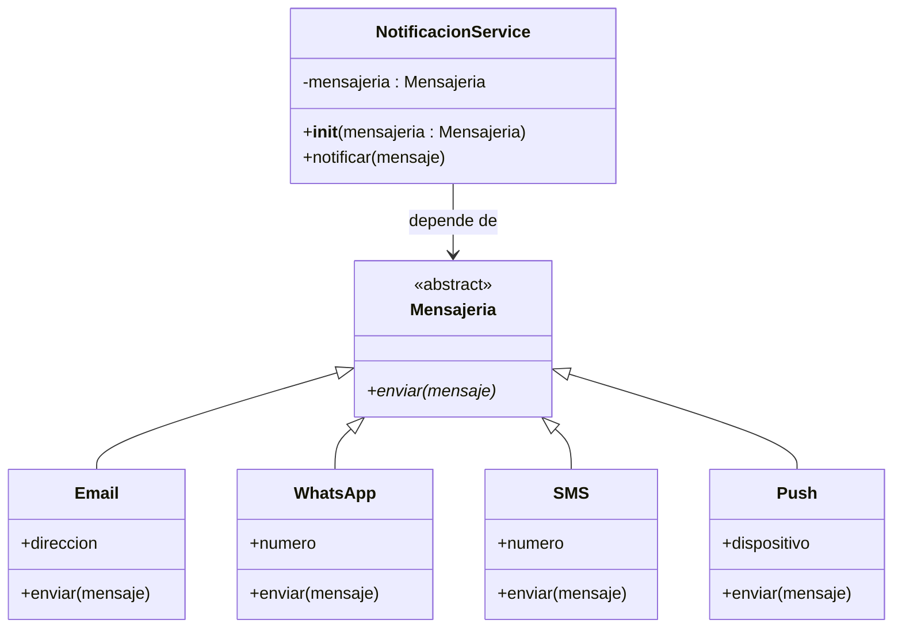
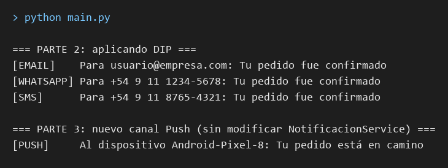

# TP11 - Principio de Inversión de Dependencias (DIP) e Inyección de Dependencias

Sistema de notificaciones que envía mensajes por **Email, WhatsApp, SMS y Push** sin que la lógica principal (`NotificacionService`) conozca ningún canal concreto.

## Requisitos

- Python 3.8 o superior. No usa librerías externas.

## Cómo ejecutar

Desde esta carpeta:

```bash
python parte1/parte1_inicial.py   # Parte 1: diseño acoplado (el problema)
python main.py                    # Partes 2 y 3: DIP con 4 canales
```

## Archivos

| Archivo | Contenido |
|---|---|
| `parte1/parte1_inicial.py` | **Parte 1**: `EmailService` y un `NotificacionService` que lo usa directamente. |
| `mensajeria.py` | **Parte 2**: clase abstracta `Mensajeria` con `enviar(mensaje)` y los canales `Email`, `WhatsApp`, `SMS`. |
| `notificacion_service.py` | **Parte 2**: `NotificacionService`, que recibe una `Mensajeria` por constructor. |
| `push.py` | **Parte 3**: nuevo canal `Push` (sin modificar `NotificacionService`). |
| `main.py` | Crea los canales, los inyecta en el servicio y envía una notificación por cada uno. |
| `preguntas.md` | Respuestas de las Partes 1 y 4. |
| `capturas/` | Capturas de la ejecución. |

## Cómo se cumplen las restricciones

- `NotificacionService` **no tiene `if`/`match`** para elegir el canal: solo llama a `self.__mensajeria.enviar(mensaje)` (polimorfismo).
- `NotificacionService` **no instancia** canales: los crea `main.py` y se los pasa por el constructor.
- El canal `Push` se agregó en un **archivo nuevo**; `notificacion_service.py` no cambió.
- Se demuestran **4 canales**: Email, WhatsApp, SMS y Push.

## Diagrama UML de clases (solución final)



`NotificacionService` solo se relaciona con la abstracción `Mensajeria`. Las flechas de herencia van **desde los detalles hacia la abstracción**: esa es la "inversión" de la dependencia.

## Capturas de ejecución

**Parte 1 – diseño acoplado**


**Partes 2 y 3 – los cuatro canales**


