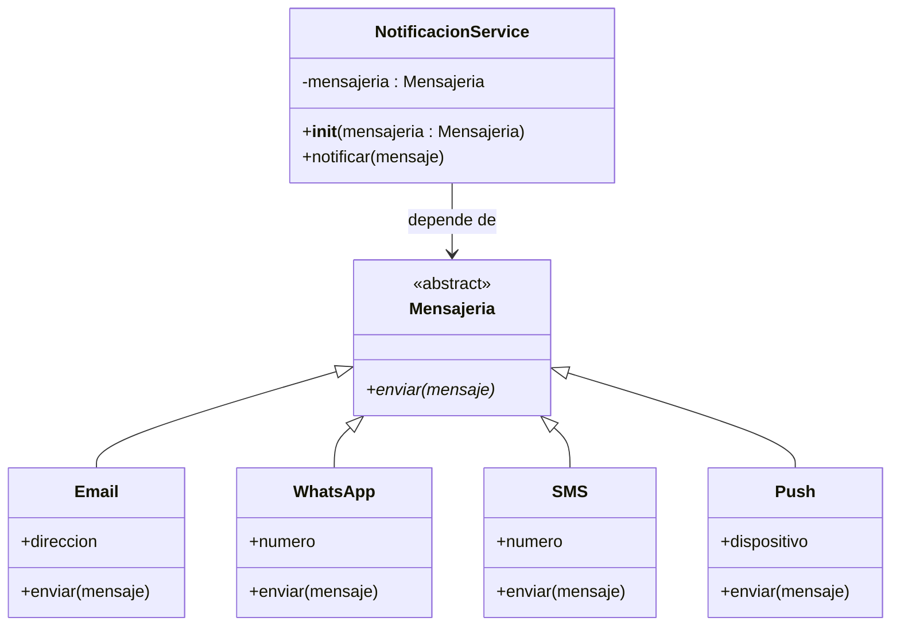
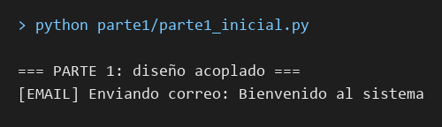

# TP11 - Principio de Inversión de Dependencias (DIP) e Inyección de Dependencias

Sistema de notificaciones que envía mensajes por **Email, WhatsApp, SMS y Push** sin que la lógica principal (`NotificacionService`) conozca ningún canal concreto.

## Requisitos

- Python 3.8 o superior.
- No usa librerías externas (solo la biblioteca estándar), por eso `requirements.txt` no lista paquetes.

## Instalación

Desde esta carpeta:

```bash
python -m venv venv                 # (opcional) entorno virtual
venv\Scripts\activate               # Windows  |  source venv/bin/activate en Linux/Mac
pip install -r requirements.txt
```

## Cómo ejecutar

Desde esta carpeta:

```bash
python parte1/parte1_inicial.py              # Parte 1: diseño acoplado (el problema)
python src/index.py                          # Partes 2 y 3: ejecuta todas las rutas
python src/index.py /notificaciones          # Solo Parte 2 (Email, WhatsApp, SMS)
python src/index.py /notificaciones/push     # Solo Parte 3 (Push)
```

## Tests

Usan `unittest` (biblioteca estándar). Desde esta carpeta:

```bash
python -m unittest -v
```

El test de `services/` inyecta un canal falso (`MensajeriaFalsa`) en `NotificacionService`: esto es posible justamente porque el servicio depende de la abstracción y no de un canal concreto.

## Estructura

```
├── src/
│   ├── controllers/                  # Recibe las solicitudes y coordina la lógica
│   │   └── notificacion_controller.py
│   ├── domain/                       # Modelos: abstracción Mensajeria y canales
│   │   ├── mensajeria.py             # Mensajeria + Email, WhatsApp, SMS
│   │   └── push.py                   # Parte 3: nuevo canal Push
│   ├── routes/                       # Rutas de la aplicación
│   │   └── notificacion_routes.py
│   ├── services/                     # Lógica de negocio
│   │   └── notificacion_service.py   # NotificacionService (depende de Mensajeria)
│   ├── dao/                          # Acceso a datos (destinatarios en memoria)
│   │   └── destinatario_dao.py
│   ├── app.py                        # Archivo principal: arma dependencias y rutas
│   └── index.py                      # Punto de entrada
├── test/                             # Tests unitarios (misma estructura que src/)
│   ├── controllers/test_notificacion_controller.py
│   ├── domain/test_mensajeria.py
│   ├── domain/test_push.py
│   ├── routes/test_notificacion_routes.py
│   ├── services/test_notificacion_service.py
│   ├── dao/test_destinatario_dao.py
│   ├── test_app.py
│   └── test_index.py
├── parte1/
│   └── parte1_inicial.py             # Parte 1: diseño acoplado
├── capturas/                         # Capturas de la ejecución
├── preguntas.md                      # Respuestas de las Partes 1 y 4
├── requirements.txt                  # Dependencias del proyecto (ninguna externa)
└── README.md                         # Documentación del proyecto
```

| Carpeta / archivo | Responsabilidad |
|---|---|
| `src/index.py` | Lee la ruta pedida por línea de comandos (o todas) y se la pasa a la app. |
| `src/app.py` | Crea el DAO y el controlador, y registra las rutas. |
| `src/routes/` | Asocia cada ruta (`/notificaciones`, `/notificaciones/push`) con un método del controlador. |
| `src/controllers/` | Crea los canales concretos con los datos del DAO y los **inyecta** en `NotificacionService`. |
| `src/services/` | `NotificacionService`: envía el mensaje a través de la abstracción `Mensajeria`. |
| `src/domain/` | `Mensajeria` (abstracta) y los canales `Email`, `WhatsApp`, `SMS`, `Push`. |
| `src/dao/` | `DestinatarioDao`: email, números y dispositivo de los destinatarios (en memoria). |

Flujo: `index.py` → `app.py` → `routes` → `controllers` → `services` → `domain` (los datos de destinatarios salen del `dao`).

## Cómo se cumplen las restricciones

- `NotificacionService` **no tiene `if`/`match`** para elegir el canal: solo llama a `self.__mensajeria.enviar(mensaje)` (polimorfismo).
- `NotificacionService` **no instancia** canales: los crea `NotificacionController` (en `src/controllers/`) y se los pasa por el constructor.
- El canal `Push` se agregó en un **archivo nuevo**; `src/services/notificacion_service.py` no cambió.
- Se demuestran **4 canales**: Email, WhatsApp, SMS y Push.

## Diagrama UML de clases (solución final)



`NotificacionService` solo se relaciona con la abstracción `Mensajeria`. Las flechas de herencia van **desde los detalles hacia la abstracción**: esa es la "inversión" de la dependencia.

## Capturas de ejecución

**Parte 1 – diseño acoplado**



**Partes 2 y 3 – los cuatro canales**


